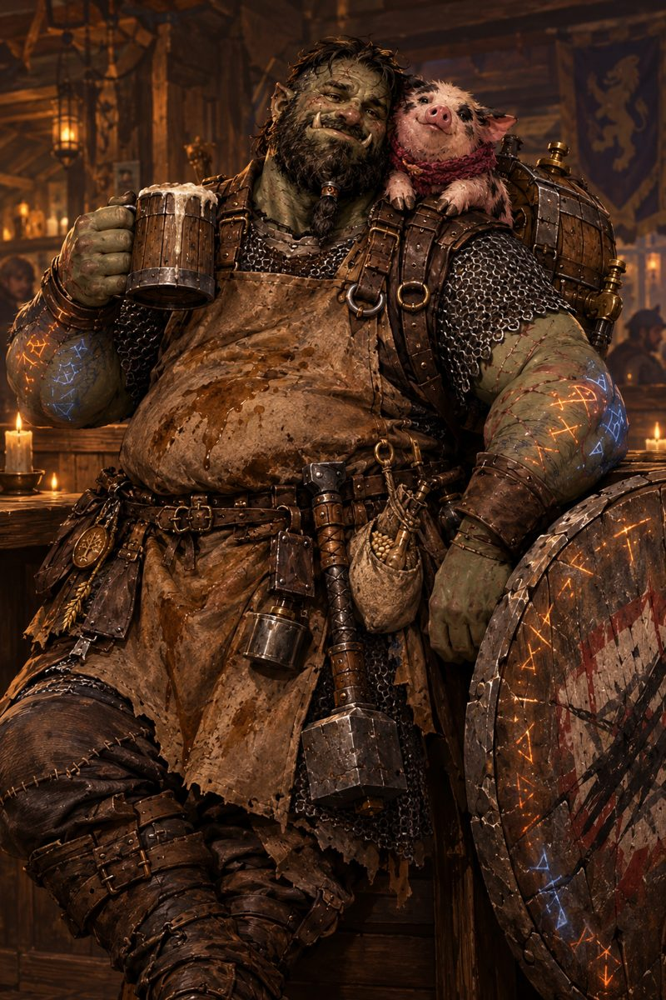

# 🍺 Sebastião "Ugrak" Bariga

Meio-orc · Guerreiro 4 (Cavaleiro Rúnico) · Cervejeiro de Porão

## ▶️ [Abrir a ficha](https://hquaiato.github.io/sebastiao/)



Ficha interativa feita em React + TypeScript + Vite, publicada no GitHub Pages pelo GitHub Actions a cada push (igual ao CellCare). Dá para instalar como app no celular.

## O que tem

- **⚔️ Jogo:** vida com −/+ e campo de dano/cura, CA, iniciativa, ataques que rolam acerto e dano num toque, e poderes com botão "Usar" e bolinhas de uso
- **🎲 Testes:** atributos, salvaguardas, perícias, ferramentas e dados
- **🎒 Itens:** moedas, equipamento e anotações
- **📖 Ficha:** habilidades, personalidade e história
- **✏️ Editar:** muda qualquer número ou texto; o resto se recalcula sozinho

## Jogador e visitante

- **Jogador:** entra com a senha do jogador e vê e edita tudo.
- **Visitante:** link [`?visitante`](https://hquaiato.github.io/sebastiao/?visitante). Vê vida, CA, atributos, perícias, ataques e usos dos poderes, atualizados a cada 15 s. Não vê habilidades, história, personalidade, itens nem anotações, e não edita nada.

## Salvar em qualquer aparelho

A ficha salva sozinha no aparelho. Para ficar igual em todos, abra **✏️ Editar** e cole um token do GitHub (fine-grained, só para o repositório `sebastiao`, com **Contents: Read and write**). Aí cada mudança é gravada no `ficha.json` deste repositório.

## Desenvolver

```bash
npm install
npm run dev
```

```
src/data/      ficha padrão
src/lib/       cálculos, dados, save/sincronização
src/components cabeçalho e rolagem
src/tabs/      telas
```
